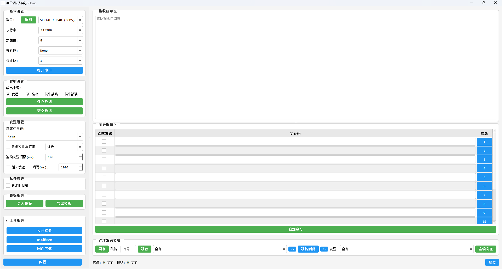

# GHowe 串口调试助手 (GHowe Serial Tool)

<p align="center">
  <strong>专为嵌入式开发者设计的高效串口调试工具</strong><br>
  <sub>版本 1.2.6 | 2026-10-14</sub>
</p>

<p align="center">
  <a href="#快速开始">快速开始</a> •
  <a href="#功能概览">功能概览</a> •
  <a href="#文档入口">文档入口</a> •
  <a href="docs/VERSION_HISTORY.md">更新历史</a> •
  <a href="docs/DEVELOPER_NOTES.md">开发文档</a>
</p>

---

## 目录

- [项目概览](#项目概览)
- [快速开始](#快速开始)
- [功能概览](#功能概览)
- [打包与入口](#打包与入口)
- [文档入口](#文档入口)
- [故障排查与支持](#故障排查与支持)

---

## 项目概览

GHowe 串口调试助手是一个功能丰富的串口调试工具，基于 PyQt5 构建，提供直观的界面、强大的命令管理、丰富的特殊指令支持，让串口调试变得简单高效。

详细操作见 [GUI 手册](docs/OPERATION_MANUAL_FOR_GUI.md)、[CLI 手册](docs/OPERATION_MANUAL_FOR_CLI.md)；远程通信见 [协议说明](docs/REMOTE_PROTOCOL.md)。

### 最新更新 (v1.2.6)

- ✅ 新增远程 BIN 上传与设备端下载，校验文件完整性并协调串口独占
- ✅ 远程设备操作增加能力检查和结果回执，区分失败、取消及结果未知
- ✅ 修复远程连接退出时并发关闭连接导致的偶发 Python 进程崩溃
- ✅ 新增 `--via-gui`，CLI 可控制已运行窗口并同步进度和结果
- ✅ 新增 `--console` 常驻控制台及显式 `--via-gui --console --machine` JSONL 机器接口;复用连接、任务终态和 RX 采集窗口,一次性 `--expect` 区分无响应与响应不匹配
- ✅ GUI 桥接失联时控制台报错退出,远程意外断连由在线 GUI/CLI 共享错误,未确认的已发操作保留结果未知
- ✅ CLI 与 GUI 共用 CSV/TXT 模板导入导出，GUI 异步处理并显示进度、支持取消；一次性命令和控制台可追加保存原始设备 RX，见 [文件操作](docs/OPERATION_MANUAL_FOR_CLI.md#模板与接收文件)
- ✅ 模板及接收保存结果在 GUI/CLI 使用相同系统提示；时间戳开关只改变显示，历史记录保留原时刻
- ✅ 桥接失败提供真实 Windows 身份及配置路径诊断；当前仍要求同用户桥接
- ✅ CLI 支持全量本机配置查询、规则查询、校验与应用，以及远程连接启停和设备端五项串口参数设置
- ✅ CLI 正常操作记录归入系统调试级别，简化完成提示
- ✅ 修复新增命令行的字体和行高不一致

👉 查看完整更新: [版本更新记录](docs/VERSION_HISTORY.md)

### 核心特性

- **智能命令管理** - 支持命令模块化组织、批量操作、模板导入导出
- **特殊指令系统** - 支持 mode、modeend、delay、SendHex、BaudRate、ComPort、SetEndlog、SendMode、StopContinuous、FirmwareDownload
- **灵活的发送模式** - 支持单次发送、连续发送、循环发送和替换发送
- **独立查找能力** - 接收区和发送编辑区可分别查找，支持大小写、正则和全字符匹配
- **替换发送能力** - 支持全局规则、命令行独立规则和正则分组替换
- **智能输出过滤** - 按来源分类显示发送、接收、系统、错误，快速定位问题
- **自动状态保存** - 配置、命令和界面布局变更后自动防抖保存，异常退出后可恢复最近状态
- **远程控制** - 支持局域网设备端/控制端串口控制
- **CLI 自动化** - 支持命令行发送字符串、十六进制和部分特殊命令
- **外部工具集成** - 支持固件下载工具、进制转换器等，完整传递串口配置和 ACK 参数

### 技术特点

- 🎯 **工具注册表机制** - 集中管理所有工具配置，易于扩展
- ⚡ **非阻塞异步执行** - 使用 QTimer 实现特殊指令，UI 始终响应
- 🔄 **版本自动兼容** - 配置文件自动迁移，无需手动升级
- 🖥️ **GUI/CLI 独立入口** - 兼容版、GUI 专用版和 CLI 专用版可同时打包，默认共用同一份配置
- 🌐 **局域网远程控制** - 支持设备端/控制端协同控制串口设备
- 🎨 **模块化架构** - 清晰的代码结构，便于维护和二次开发
- 🔧 **完整串口参数** - 支持数据位、校验位、停止位完整配置传递
- 📋 **标准 CSV 处理** - 符合 RFC 4180 标准，兼容 Excel/LibreOffice

### 主界面预览

> 
>
> **界面布局说明**：
> - 左侧：命令表格区域（支持批量操作）
> - 中间：接收显示区（实时显示通信数据）
> - 右侧：配置面板（串口设置、发送设置）

### 适用场景

- **嵌入式设备调试** - GPS 模块、GSM 模块、传感器等
- **寄存器配置** - 芯片寄存器读写、参数配置
- **协议测试** - AT 指令测试、自定义通信协议验证
- **批量测试** - 设备稳定性测试、压力测试
- **自动化脚本** - 通过 CLI 执行固定串口命令或模块流程

---

## 快速开始

### 环境要求

- **Python**: 3.10+
- **操作系统**: Windows / Linux / macOS
- **依赖库**:
  - PyQt5 (≥5.15,<6) - GUI 框架及本机 IPC
  - pyserial (≥3.5,<4) - 串口通信
  - jsonschema (≥4.18,<5) - 在线配置校验
  - prompt_toolkit (≥3.0.43,<4) - CLI 交互控制台

### 安装依赖

```bash
python -m pip install -r requirements.txt
```

按需可使用虚拟环境；不是打包前提。手动构建见下方[打包与入口](#打包与入口)。

### 启动 GUI

```bash
cd serial_tool_project
python main.py
```

或者运行纯 GUI 入口：

```bash
python gui_main.py
```

GUI 操作、快捷键、查找、替换发送、连续发送、循环发送和特殊命令说明见 [GUI 操作手册](docs/OPERATION_MANUAL_FOR_GUI.md)。

### 启动 CLI

```bash
cd serial_tool_project
python cli_main.py --help
```

通用入口也可以进入 CLI：

```bash
python main.py --cli --port COM3 --baudrate 115200 --send "AT"
```

CLI 参数、配置文件、特殊命令支持范围和自动化示例见 [CLI 操作手册](docs/OPERATION_MANUAL_FOR_CLI.md)。

---

## 功能概览

### GUI 能力

GUI 提供完整的串口调试工作台，适合交互式调试、命令模板维护和长时间测试。

- 串口连接、断开、刷新和参数配置
- 接收显示、来源过滤、保存数据和清空数据
- 命令行编辑、批量选择、模块管理和模板导入导出
- 接收区与发送编辑区独立查找
- 全局和单行规则的替换发送
- 连续发送、循环发送和模块跳转
- 远程控制和外部工具集成

详细 GUI 操作请直接查看：[GUI 操作手册](docs/OPERATION_MANUAL_FOR_GUI.md)。

### CLI 能力

CLI 适合脚本化调用、自动化测试和 CI/本地批处理。

- 使用配置文件打开串口
- 命令行覆盖串口号和波特率
- 发送普通字符串或十六进制数据
- 执行配置中的模块
- 发送后读取设备响应
- 使用 --via-gui --console --machine 接收正式 UTF-8 JSONL 机器事件与显式 RX 窗口,由调用方匹配响应和停止失败
- 使用常驻控制台连续调试，或通过 `--via-gui --config` 操作已运行 GUI
- 独立CLI与GUI共用日志收录和分块后台归档;显示/日志时间戳独立,支持日志配置查询/校验/原子应用、实际归档状态及显式另存恢复. 参数为`--log-action`,控制台为`LogGet/LogCheck/LogApply/LogStatus/LogRecover`,详见CLI手册.
- 一次性 `--expect` 返回匹配结果及有界接收摘要，便于 Agent 判断响应
- 返回进程退出码，便于脚本判断成功或失败

完整 CLI 参数和示例请查看：[CLI 操作手册](docs/OPERATION_MANUAL_FOR_CLI.md)。

### 特殊命令

当前支持的特殊命令包括：

```text
mode, modeend, delay, SendHex, BaudRate, ComPort, SetEndlog, SendMode, StopContinuous, FirmwareDownload
```

特殊命令在 GUI 和 CLI 中的支持范围不同。格式、示例和差异说明请查看：

- [GUI 操作手册 - 特殊命令](docs/OPERATION_MANUAL_FOR_GUI.md#9-特殊命令)
- [CLI 操作手册 - 命令与语义](docs/OPERATION_MANUAL_FOR_CLI.md#命令与语义)

---

## 打包与入口

### 打包命令

需要内置固件下载时，将配套的 `firmware_downloader_project` 源码放在本项目同级目录；下载核心与协议直接从该仓库复用，不是 `requirements.txt` 中的 PyPI 包。两仓需使用配套源码，详见 [开发说明](docs/DEVELOPER_NOTES.md)。

由用户在 `serial_tool_project` 目录手动运行（PyInstaller 属于构建工具，按需安装）：

```bash
python -m pip install -r requirements.txt pyinstaller
python -m PyInstaller main.spec
```

使用安装了 `requirements.txt` 的同一 Python 执行 `python -m PyInstaller`，避免打包命令指向其他环境。
打包配置会排除未使用的语法着色、图片导出和 HTTP Schema 扩展，无需为控制 EXE 体积卸载系统环境中的其他库。
CLI 产物仍包含 QtCore/QtNetwork 用于本机通信，但不包含 QtWidgets/QtGui；GUI 产物保留完整界面依赖。

### 可执行文件

| 文件 | 说明 |
|------|------|
| `GHowe_串口调试助手.exe` | 通用版，默认 GUI，支持 `--cli` |
| `GHowe_串口调试助手_GUI.exe` | 纯 GUI 版，不显示控制台 |
| `GHowe_串口调试助手_CLI.exe` | 纯 CLI 版，适合脚本和自动化 |

GUI、通用 EXE 和 CLI EXE 会打包 GUI/CLI 两份操作手册，便于随发布包分发。

GitHub Release 上传时会在扩展名前追加版本号，例如 `GHowe_串口调试助手_GUI_v1.2.6.exe`；本地执行上述打包命令时仍使用表中的文件名。重命名或跨工作目录启动可能改变默认配置路径，GUI/CLI 协作时显式指定 GUI 的实际配置绝对路径。

---

## 文档入口

📚 **完整文档集**

- [🖥️ GUI 操作手册](docs/OPERATION_MANUAL_FOR_GUI.md) - 图形界面、快捷键、查找、替换发送、连续发送、特殊命令
- [⌨️ CLI 操作手册](docs/OPERATION_MANUAL_FOR_CLI.md) - 命令行启动、参数、配置、特殊命令支持范围
- [📋 版本更新记录](docs/VERSION_HISTORY.md) - 所有版本的功能变更和 Bug 修复
- [🔧 开发者笔记](docs/DEVELOPER_NOTES.md) - 架构设计、扩展开发、技术细节

在 GUI 中也可以点击左下角 `?` 或按 `F1` 打开内置帮助。内置帮助只显示 GUI 和 CLI 两份操作手册，不显示 README。

---

## 故障排查与支持

常见串口问题通常与端口占用、参数不匹配、结尾符设置或设备未就绪有关。具体操作建议请优先查看 [GUI 操作手册](docs/OPERATION_MANUAL_FOR_GUI.md#11-常见问题)。

如果需要反馈问题，建议附带：

- 工具版本和运行入口
- Python 与操作系统版本
- 串口参数和复现步骤
- 控制台错误或接收显示区错误信息
- 可公开的最小配置或模板

### 反馈与贡献

- **问题反馈**: 提交 Issue 到项目仓库
- **功能建议**: 在 Issue 中描述您的需求
- **代码贡献**: Fork 项目，提交 Pull Request
- **文档改进**: 修正错误或补充文档内容

**贡献者指南**: 参考 [开发者笔记](docs/DEVELOPER_NOTES.md#贡献指南)

---

## 许可证

本项目采用 Apache-2.0 license 开源协议。

---

<p align="center">
  <strong>GHowe 串口调试助手 - 让串口调试更简单</strong><br>
  Made with ❤️ by GHowe
</p>
